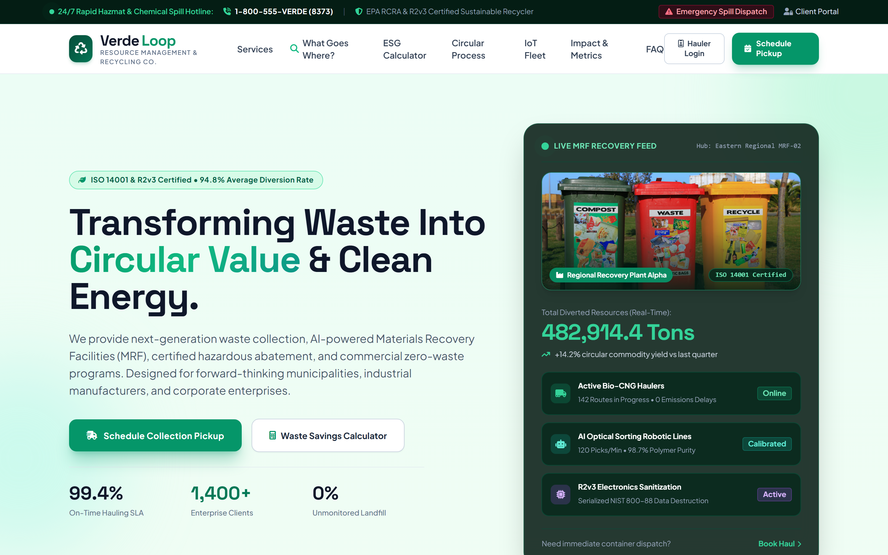

# VerdeLoop Resource Management & Recycling Co.

A state-of-the-art enterprise website and digital operational platform for a modern waste collection, environmental management, and circular recycling enterprise.



## 🌐 Live Deployments

- **Production Website**: [https://ecoverde-waste-recycling.vercel.app](https://ecoverde-waste-recycling.vercel.app)
- **GitHub Repository**: [https://github.com/wanjikudigitaldesignservices-cyber/ecoverde-waste-recycling](https://github.com/wanjikudigitaldesignservices-cyber/ecoverde-waste-recycling)


## 🚀 Key Features

1. **Intelligent "What Goes Where?" Waste Sorter**:
   - Interactive database of 18+ categorized items (paper, plastics, organic compost, metals, glass, e-waste, hazardous, and C&D).
   - Real-time search and category filtering with instant bin categorization (Blue, Green, Yellow, Gray, Red Hazmat).
   - Preparation advice and circular diversion destination for each item.
   - Quick one-click "Request Pickup" integration that pre-fills booking notes.

2. **Commercial & ESG Waste Savings Calculator**:
   - Real-time simulation of financial tipping-fee reductions vs landfill disposal based on the EPA WARM model.
   - Dynamic sliders for monthly waste volume (2 to 250 tons) and target diversion percentage (30% to 98%).
   - Dynamic metrics: Net Annual Cost Savings ($), Landfill Diverted Tonnage, MT CO2e avoided, and Equivalent Trees Saved.

3. **Step-by-Step Pickup Scheduling & Booking Wizard**:
   - 4-step interactive flow:
     - **Step 1**: Waste Stream / Container selection (Dumpsters, Bulky items, ITAD/E-Waste, Construction Roll-off, Hazmat, Composting).
     - **Step 2**: Pickup Location & Contact information with gate code and dock instructions.
     - **Step 3**: Preferred Date, Time Window, and Container Size (64-gal carts to 40-yd roll-offs).
     - **Step 4**: Dispatch Summary Review and confirmation.
   - Generates a unique tracking reference code (`#VL-XXXXXX`) and simulated GPS routing dispatch.

4. **Circular Economy Recovery Flow**:
   - Interactive 4-stage breakdown: Smart IoT Collection -> Robotic Optical Sorting -> Pure-Stream Reprocessing -> Closed-Loop Re-entry.

5. **Smart Fleet & IoT Telemetry Command Center**:
   - Live simulated ultrasonic fill-level sensors with animated capacity bars, tamper alerts, and auto-dispatch statuses.

6. **ESG Compliance & Analytics (Interactive Chart.js Visualizations)**:
   - Donut chart displaying recovered circular commodity composition.
   - Bar chart illustrating 4-year growth in landfill diversion vs declining residual volume.

7. **Specialized Enterprise Modals & Safety Features**:
   - **Operational Specification Modal**: In-depth regulatory details for all 6 service lines.
   - **Customer Portal Modal**: Mock sign-in for access to digital weigh tickets, manifests, and ESG invoices.
   - **24/7 Emergency Hazmat Spill Drawer**: Rapid alert broadcasting for chemical spills and regulated containment.
   - **Toast Notification Engine**: Non-intrusive real-time feedback for all user actions.

## 📁 Project Structure

```
ecoverde-waste-recycling/
├── index.html        # Main application markup and UI components
├── app.js            # Core interactive logic, databases, calculator, wizard, and charts
├── styles.css         # Glassmorphism effects, custom badges, animations, and typography
├── vercel.json       # Clean URL routing configuration
└── README.md         # Comprehensive project documentation
```

## 🛠️ Tech Stack

- **HTML5 & CSS3** with modern semantics and accessibility
- **Tailwind CSS** (v3 CDN) with custom palette extension
- **Vanilla JavaScript** (ES6+) with modular event-driven architecture
- **Chart.js** for high-resolution responsive canvas analytics
- **Font Awesome 6** for crisp iconography
- **Google Fonts** (Plus Jakarta Sans & Space Grotesk)
